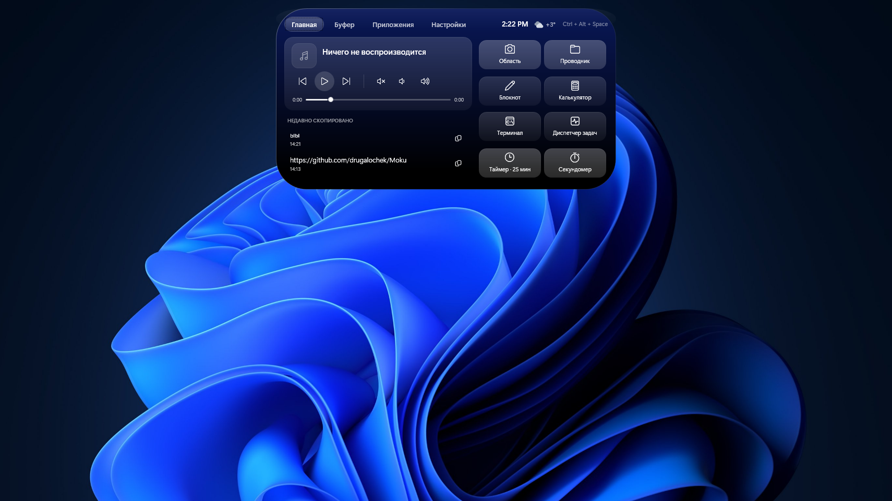
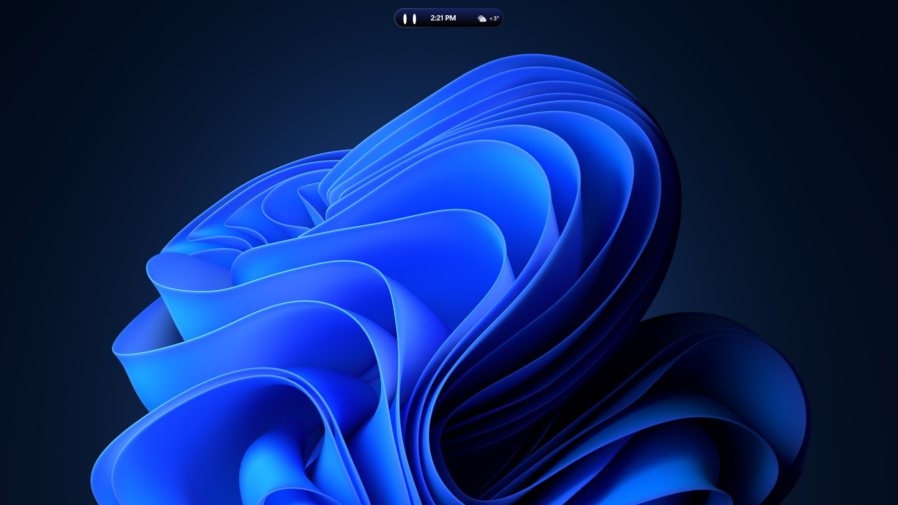
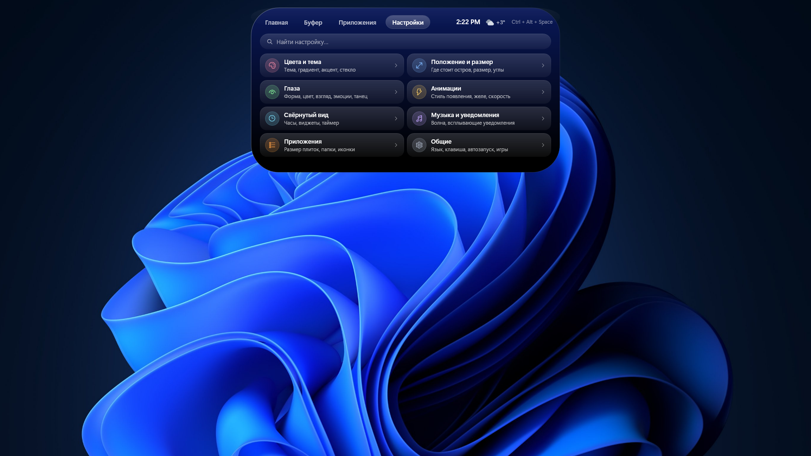
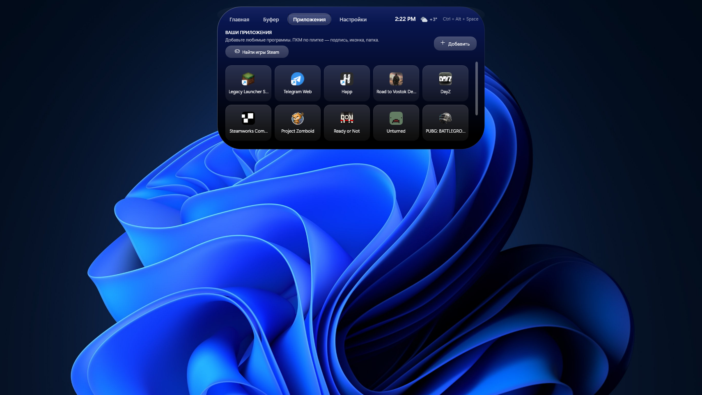

# 🏝️ Moku

### Живой «Dynamic Island» для Windows · A living Dynamic Island for Windows

Живой остров для Windows: время, погода, музыка, скриншоты, буфер обмена, запущенные окна, файлы и папки, игры Steam.

 

  

  

**[🇷🇺 Русский](#ru)** &nbsp;│&nbsp; **[🇬🇧 English](#en)**

 

---

## 🇷🇺 Русский

**Moku** — компактный интерактивный остров для Windows 10 и 11. В свёрнутом виде это маленькая «пилюля» с живыми глазками и нужной информацией, а по клику он мягко раскрывается в панель с музыкой, погодой, инструментами и настройками.

### 📸 Скриншоты

Галерея показывает общий стиль интерфейса. Новые функции версии 2.12.1 перечислены ниже.

  
   
  🏠 <b>Главная</b> — музыка, недавно скопированное и быстрые инструменты

<table>
  <tr>
    <td width="50%" align="center">
      
       🎵 <b>Музыка</b> — обложка, управление и живая волна
    </td>
    <td width="50%" align="center">
      
       🕒 <b>Свёрнутый вид</b> — глазки, время и погода
    </td>
  </tr>
  <tr>
    <td width="50%" align="center">
      
       ⚙️ <b>Настройки</b> — разделы, поиск и отдельный сброс
    </td>
    <td width="50%" align="center">
      
       🚀 <b>Приложения</b> — игры Steam и любимые программы
    </td>
  </tr>
</table>

### 🆕 Что нового в 2.12.1

> - 🏠 **Главная без лишних кнопок** — в настройках выбирается один блок: буфер обмена или запущенные приложения. На самой Главной нет переключателя и кнопок «Свернуть всё / Развернуть всё».
> - 🪟 **Запущенные приложения** — группировка окон, точки по их количеству, переключение на существующее окно и восстановление свёрнутого. Обычный клик не создаёт новые копии; быстрые повторы запуска блокируются.
> - 🖼️ **Превью в стиле острова** — предпросмотр окон при наведении сохранён. Рамка и изображение используют общую настройку скругления; для свёрнутых или защищённых окон картинка может быть недоступна.
> - 📁 **Удобные папки** — кнопка «Создать папку», переименование и сохранение пустых папок. Приложения перетаскиваются внутрь, крестик внутри возвращает их в общий список. Сами папки тоже можно переставлять перетаскиванием.
> - 📄 **Не только EXE** — добавление нескольких файлов: PNG, DLL, ярлыков, BAT/CMD/PS1 и других типов. Документы открываются своей программой Windows; DLL не запускается как отдельное приложение.
> - 🛡️ **Обычный запуск или от администратора** — отдельные команды в меню ПКМ для поддерживаемых файлов. Повышение прав подтверждается системным запросом UAC.
> - 🎮 **Steam под стрелкой** — список игр для добавления сворачивается прямо в «Приложениях». Игры добавляются вручную по плюсу, без отдельных настроек скрытых игр и автоматического добавления всего списка.
> - 🎨 **Собственные меню ПКМ** — тёмные меню и подменю в цветах темы, с общей настройкой скругления. Убрана причина залипания подсветки быстрых действий справа на Главной.
> - ⌨️ **Своя горячая клавиша** — по умолчанию **Alt + Space**, без пресетов. Можно записать сочетание или одну клавишу, например F8; Esc отменяет запись, занятая привязка не заменяет прежнюю.

Поиск настроек, разделы и сброс выбранного раздела сохранены. Трея нет — выход доступен в интерфейсе Moku.

### ✨ Возможности

| | |
|---|---|
| 👀 **Живые глазки** Следят за курсором, моргают, засыпают ночью, радуются, скучают и зевают. Если «погладить» их курсором — блаженно жмурятся с румянцем. | 🎵 **Музыка** Название трека, обложка альбома, управление плеером. Moku определяет темп (BPM), и глазки танцуют в такт. |
| 🫧 **Жидкий остров** Пока играет музыка, нижний край превращается в живую волну. Раскрытие — на «желейной» пружинной анимации. | 🎭 **Кастомизация глаз** 7 форм: овалы, круглые, точки, аниме, «^ ^», робот, кошачьи. Размер, расстояние, цвет, свечение, частота моргания. |
| 🕒 **Свёрнутый вид на выбор** Время, дата, погода, батарея, загрузка CPU или RAM. 12/24 ч, секунды, таймер и секундомер. | 🌦️ **Погода** Температура и значок через Open-Meteo, обновление примерно раз в 15 минут, кэш последнего значения. |
| 📸 **Скриншоты с разметкой** Область или весь экран. Перо, стрелка, рамка, маркер, цвета и толщина. | 📋 **История буфера обмена** От 5 до 200 записей, быстрые уведомления при копировании. |
| 🚀 **Приложения и игры** Плитки для быстрого запуска, настоящие иконки Steam-игр, папки, свои подписи и иконки, перестановка перетаскиванием. | 🎮 **Игровой режим** В полноэкранных играх остров плавно становится прозрачным и не мешает кликам. |
| ✨ **Стили появления** «Пружина», «Плавно» или «Капля», отдельные скорости раскрытия и уведомлений. | 🌐 **Два языка** Русский и English. Трея нет; управление и выход — в интерфейсе острова. |
| 🪟 **Главная на выбор** Буфер обмена или запущенные приложения — выбирается в настройках. Группы окон, точки и скруглённые превью. | 📄 **Файлы и скрипты** EXE, ярлыки, PNG, DLL, BAT/CMD/PS1 и другие файлы. Для поддерживаемых типов — отдельный запуск от администратора через UAC. |
| 📁 **Папки и плитки** Создание, переименование, перетаскивание папок и файлов. Крестик внутри папки возвращает файл в корень. Размеры плиток: 1×1, 2×1 и 2×2. | 🎮 **Игры Steam** Список доступных игр под стрелкой прямо в «Приложениях». Ручное добавление по плюсу, сохранение состояния списка. |
| 🎨 **Меню в стиле Moku** Свои тёмные меню ПКМ и подменю, оттенок темы и общая настройка скругления. | ⌨️ **Своя горячая клавиша** Alt + Space по умолчанию. Запись сочетания или одной клавиши, отмена по Esc и сохранение прежней привязки при конфликте. |

### 📦 Установка

1. Нажми кнопку **[⬇ Скачать Moku 2.12.1](https://github.com/drugalochek/Moku/releases/download/Release/Moku-Setup-2.12.1-x64.exe)** (файл `Moku-Setup-2.12.1-x64.exe`, ~144 МБ).
2. Запусти установщик и пройди шаги: Лицензия → Папка → Установка → Готово.
3. Moku появится вверху экрана. Кликни по острову, чтобы раскрыть его.

> [!NOTE]
> Установщик не подписан цифровой подписью, поэтому Windows SmartScreen может показать предупреждение. Нажми **«Подробнее» → «Выполнить в любом случае»**.
> Для погоды нужен интернет. Нужна 64-битная Windows 10 или 11.

### 🎮 Управление

| Действие | Как |
|---|---|
| Раскрыть / свернуть остров | Клик по острову или **Alt + Space** (сочетание меняется в настройках) |
| Свернуть | **Esc** или клик мимо острова |
| Выбрать содержимое Главной | Настройки → Главная → «На Главной показывать» |
| Изменить горячую клавишу | Настройки → Общие → Горячая клавиша → «Изменить» |
| Создать папку | Приложения → «Создать папку»; затем перетащи в неё плитки |
| Вынуть файл из папки | Крестик на плитке внутри папки или перенос на «Назад» |
| Запустить от администратора | ПКМ по плитке → «Запустить от имени администратора» (поддерживаемые типы) |
| Показать / скрыть предложения Steam | Стрелка над списком доступных игр в «Приложениях» |
| Завершить Moku | Кнопка выхода в интерфейсе острова; значка в трее нет |

<b>📸 Горячие клавиши редактора скриншотов</b>

 

| Клавиши | Действие |
|---|---|
| `Enter` / `Ctrl + C` | Скопировать в буфер обмена |
| `Ctrl + S` | Сохранить PNG |
| `Ctrl + Z` | Отменить последнее действие |
| `Esc` | Закрыть редактор |

Плитка **«Область»** — выделить часть экрана и разметить её. Плитка **«Экран»** — снимок всего экрана сразу в буфер обмена.

<b>⚙️ Где хранятся настройки и данные</b>

 

| Что | Путь |
|---|---|
| Настройки | `%APPDATA%\Moku\settings.json` |
| Кэш погоды | `%APPDATA%\Moku\weather-cache.json` |
| Лог | `%APPDATA%\Moku\moku.log` |

<b>🧩 Технологии</b>

 

C# · .NET 8 · WPF · Windows Media Session API · WASAPI · Open-Meteo Weather API

<a href="#en">English ↓</a>

---

## 🇬🇧 English

**Moku** is a compact interactive island for Windows 10 and 11. Collapsed, it is a small pill with living eyes and the info you need; click it and it smoothly expands into a panel with music, weather, tools and settings.

### 📸 Screenshots

The gallery shows the overall interface style. New features in 2.12.1 are listed below.

  
   
  🏠 <b>Home</b> — music, recently copied items and quick tools

<table>
  <tr>
    <td width="50%" align="center">
      
       🎵 <b>Now playing</b> — album art, controls and a living wave
    </td>
    <td width="50%" align="center">
      
       🕒 <b>Collapsed view</b> — eyes, time and weather
    </td>
  </tr>
  <tr>
    <td width="50%" align="center">
      
       ⚙️ <b>Settings</b> — categories, search and per-section reset
    </td>
    <td width="50%" align="center">
      
       🚀 <b>Apps</b> — Steam games and favourite programs
    </td>
  </tr>
</table>

### 🆕 What's new in 2.12.1

> - 🏠 **A simpler Home tab** — choose one block in Settings: clipboard or running apps. Home has no view switch or Minimize all / Restore all buttons.
> - 🪟 **Running apps** — grouped windows, window-count dots, activation of existing windows and restoration of minimized ones. Normal clicks do not create extra copies; rapid repeated launches are blocked.
> - 🖼️ **Island-styled previews** — hover previews are retained. Both the frame and image follow the shared corner-radius setting; previews may be unavailable for minimized or protected windows.
> - 📁 **Better folders** — a Create folder button, renaming and persistent empty folders. Drag apps into a folder; use the cross inside to move them back to the main list. Folders themselves can also be reordered by dragging.
> - 📄 **More than EXE files** — add multiple files, including PNG, DLL, shortcuts, BAT/CMD/PS1 and other types. Documents open in their Windows-associated app; DLLs are not treated as standalone programs.
> - 🛡️ **Normal or administrator launch** — separate right-click commands for supported file types. Elevation uses the standard Windows UAC confirmation.
> - 🎮 **Collapsible Steam suggestions** — expand or hide available games directly in Apps. Add games manually with +, without separate hidden-game settings or automatic bulk adding.
> - 🎨 **Custom context menus** — dark themed menus and submenus with shared rounding. The cause of sticky highlighting on Home quick-action buttons has been removed.
> - ⌨️ **Your own hotkey** — **Alt + Space** by default, without presets. Record a combination or a single key such as F8; Esc cancels, and an occupied binding does not replace the previous one.

Settings search, categories and per-section reset are retained. There is no system tray icon; use the exit control in Moku's interface.

### ✨ Features

| | |
|---|---|
| 👀 **Living eyes** Follow the cursor, blink, fall asleep at night, get happy, bored and yawn. "Pet" them with the cursor and they blush. | 🎵 **Music** Track title, album art and playback controls. Moku detects the tempo (BPM) and the eyes dance to the beat. |
| 🫧 **Liquid island** While music plays, the lower edge turns into a living wave. Expanding uses a jelly spring animation. | 🎭 **Eye customization** 7 shapes: ovals, round, dots, anime, "^ ^", robot, cat. Size, spacing, color, glow and blink rate. |
| 🕒 **Custom collapsed view** Time, date, weather, battery, CPU or RAM. 12/24 h, seconds, timer and stopwatch. | 🌦️ **Weather** Temperature and icon via Open-Meteo, refreshed about every 15 minutes, with cache. |
| 📸 **Screenshots with markup** Area or full screen. Pen, arrow, rectangle, highlighter, colors and thickness. | 📋 **Clipboard history** 5 to 200 entries, quick toasts on copy. |
| 🚀 **Apps & games** Quick-launch tiles, real Steam game icons, folders, custom names and icons, drag & drop reordering. | 🎮 **Game mode** In fullscreen games the island smoothly turns transparent and click-through. |
| ✨ **Appear styles** Spring, Smooth or Drop, with separate expand and notification speeds. | 🌐 **Two languages** English and Russian. No system tray icon; controls and exit are in the island interface. |
| 🪟 **Choose your Home view** Clipboard or running apps, selected in Settings. Window groups, count dots and rounded hover previews. | 📄 **Files & scripts** EXE, shortcuts, PNG, DLL, BAT/CMD/PS1 and other files. Supported types have a separate administrator launch command using UAC. |
| 📁 **Folders & tiles** Create, rename and drag folders and files. The cross inside a folder moves a file back to the main list. Tile sizes: 1×1, 2×1 and 2×2. | 🎮 **Steam games** A collapsible list of available games directly in Apps. Add games manually with +; the expanded state is saved. |
| 🎨 **Moku-styled menus** Custom dark context menus and submenus, theme tint and shared corner radius. | ⌨️ **Custom hotkey** Alt + Space by default. Record a combination or single key, cancel with Esc and keep the previous binding if the new one is occupied. |

### 📦 Installation

1. Click **[⬇ Download Moku 2.12.1](https://github.com/drugalochek/Moku/releases/download/Release/Moku-Setup-2.12.1-x64.exe)** (`Moku-Setup-2.12.1-x64.exe`, ~144 MB).
2. Run the installer: License → Folder → Install → Done.
3. Moku appears at the top of the screen. Click the island to expand it.

> [!NOTE]
> The installer is not code-signed, so Windows SmartScreen may show a warning. Click **More info → Run anyway**.
> Weather requires an internet connection. Requires 64-bit Windows 10 or 11.

### 🎮 Controls

| Action | How |
|---|---|
| Expand / collapse | Click the island or press **Alt + Space** (configurable in Settings) |
| Collapse | **Esc** or click outside the island |
| Choose Home content | Settings → Home → Show on Home |
| Change the hotkey | Settings → General → Hotkey → Change |
| Create a folder | Apps → Create folder; then drag tiles into it |
| Move a file out of a folder | The cross inside the folder, or drag onto Back |
| Run as administrator | Right-click a tile → Run as administrator (supported types) |
| Show / hide Steam suggestions | The arrow above available games in Apps |
| Exit Moku | Use the exit control in the island interface; there is no tray icon |

<b>📸 Screenshot editor shortcuts</b>

 

| Keys | Action |
|---|---|
| `Enter` / `Ctrl + C` | Copy to clipboard |
| `Ctrl + S` | Save as PNG |
| `Ctrl + Z` | Undo |
| `Esc` | Close the editor |

**Area** — select part of the screen and annotate it. **Screen** — capture the whole screen straight to the clipboard.

<b>⚙️ Settings and local data</b>

 

| What | Path |
|---|---|
| Settings | `%APPDATA%\Moku\settings.json` |
| Weather cache | `%APPDATA%\Moku\weather-cache.json` |
| Log | `%APPDATA%\Moku\moku.log` |

<b>🧩 Built with</b>

 

C# · .NET 8 · WPF · Windows Media Session API · WASAPI · Open-Meteo Weather API

<a href="#ru">↑ Русский</a>

---

Сделано с 💙 · Made with 💙

